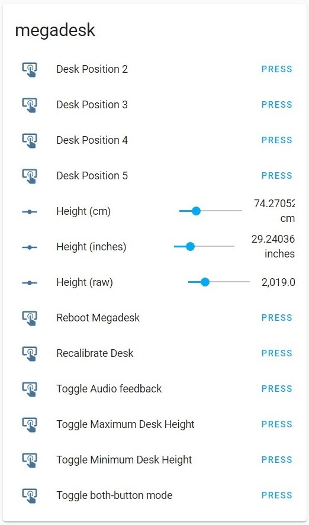

## megadesk companion
[megadesk companion](https://github.com/gcormier/megadesk_companion) is available for plug and play esphome/homeassistant integration.

# esphome configuration
This is only an example for home-built ESP8266 boards such as the Wemos D1 Mini. Any esphome compatible device can be used.

The example configuration is [esphome/megadesk-8266.yaml](esphome/megadesk-8266.yaml). It uses the
`megadesk` external component in [esphome/components/megadesk](esphome/components/megadesk), which
parses the serial responses Megadesk sends back. Commands to Megadesk are plain `uart.write` actions
in the YAML.

Megadesk must be running firmware compiled with `SERIALCOMMS` and `HUMANSERIAL` (see [Serial.md](Serial.md)).

The YAML expects three entries in a `secrets.yaml` next to it: `wifi_ssid`, `wifi_password` and
`megadesk_fallback_ap_password` (the password for the fallback hotspot the ESP brings up if it can't
join your Wi-Fi).

Do NOT use the 5V from the Megadesk to power your esphome controller. Megadesk does not have the ability to dissipate
the amount of heat produced by the linear regulators with a high-power device. These devices can requires 100-300mA of current. For comparison, the megadesk itself only requires 10-15mA.

There exists one device with a built-in buck converter that could take the 24V power - https://www.ezsbc.com/product/wifi01-sw/ (unaffiliated and not tested)

Connections will be
```
MISO -> RX
SCK -> TX
GND -> GND
```

The example uses the ESP8266 hardware UART (`TX`/`RX`, GPIO1/GPIO3) at 115200 8N1 and turns the
logger's serial output off (`logger: baud_rate: 0`) so the two don't fight over the port. Other pins
work too; ESPHome falls back to software serial for them.

## Using the component
The YAML pulls the component straight from this repository:

```yaml
external_components:
  - source: github://gcormier/megadesk
    components: [megadesk]
```

If you would rather keep a local copy, copy `esphome/components/megadesk` next to your YAML and use
`type: local` instead (the example has the alternative commented out). The `github://` source only
works once the component is on `master`; to try it from a branch, use
`github://gcormier/megadesk@<branch>` or the local copy.

The component exposes three optional sensors:

| Sensor       | Meaning                                                              |
|--------------|----------------------------------------------------------------------|
| `raw_height` | Current position, updated whenever Megadesk reports it (`>=...`)     |
| `min_height` | Contents of EEPROM slot 11 (minimum height limit), from `>R...,11`   |
| `max_height` | Contents of EEPROM slot 12 (maximum height limit), from `>R...,12`   |

All three are **raw Megadesk positions**, not inches or centimetres.

The example YAML adds two read-only template sensors on top, `Megadesk Current Height (inches)` and
`(cm)`, so the current height is visible as a number. The sliders in the ESPHome web page are bare
range controls and don't show their value, so those sensors are what you read; the sliders are what
you drag.

The component requires the UART to be 115200 8N1 with both TX and RX configured, and fails
validation at build time otherwise. That matches what stock Megadesk firmware uses
(`userSerial.begin(115200)`).

## Raw positions vs. physical height
Megadesk works in raw positions. Its firmware only accepts targets between `DANGER_MIN_HEIGHT` (299)
and `DANGER_MAX_HEIGHT` (6640); see `code/src/megadesk.cpp`. The raw slider in the example uses that
range directly.

The inch and centimetre sliders are a convenience layer on top. Raw positions map to physical height
linearly, but where that line sits depends on your desk, your desktop thickness, and where you measure
from, so the example doesn't hard-code one answer. Instead it takes a three-point calibration from
`substitutions:` and fits a straight line through the points at compile time.

### Calibrating your desk
1. Pick one fixed reference, e.g. floor to the underside of the desktop.
2. Move the desk to a low position. Note the raw position Megadesk **reports** (the raw slider /
   `raw_height` sensor), and measure the height.
3. Repeat at a high position and at a position roughly in the middle.
4. Enter the six numbers as `megadesk_cal_raw_low` / `megadesk_cal_height_low_in`,
   `megadesk_cal_raw_mid` / `megadesk_cal_height_mid_in`, `megadesk_cal_raw_high` /
   `megadesk_cal_height_high_in`.
5. Work out the slider limits at the raw limits and enter them as `megadesk_height_min_in` /
   `megadesk_height_max_in` (and the cm equivalents, `cm = in * 2.54`). With the line through your low
   and high points:

```
slope  = (height_high - height_low) / (raw_high - raw_low)
offset = height_low - slope * raw_low
height at 299  = slope * 299  + offset
height at 6640 = slope * 6640 + offset
```

The middle point is the check that the desk really is linear: the fitted line should pass within a
small fraction of an inch of all three measurements (on the example desk the largest residual was
about 0.02 in). If one point is well off the line, re-measure it.

The YAML fits the line by least squares across the three points, so it doesn't matter whether the
middle point is exactly in the middle. The fit is `constexpr` and evaluated by the compiler; only the
two resulting constants end up in the firmware.

Centimetres are derived from the inch calibration with exactly 2.54, so the two sliders always agree.
Every physical set request is converted back to raw and clamped to `299..6640` before it's sent, so
slider limits that are slightly off can't push Megadesk outside its accepted range.

Note that the **Recalibrate Desk** button is something else: it runs Megadesk's motor recalibration
(slot 14), which lowers the desk until both legs bottom out and re-zeroes the leg encoders. Re-check
your height calibration after using it.

### Migrating from the old custom component
Before this version the example used `includes: [megadesk.h]` and `platform: custom`, which ESPHome
has removed. The old parser also called `read()` on an empty UART buffer, which on current ESPHome
blocks the main loop for the UART timeout (`Reading from UART timed out at byte 0!`,
`megadesk took a long time for an operation`). Its inch/cm conversions could also request raw
positions above 6640, which Megadesk rejects.

To migrate, replace your YAML with the new example (keeping your own Wi-Fi, board and pin settings)
and delete `megadesk.h` from your configuration directory. Existing entity names are unchanged; three
new read-only current-height sensors appear.

### example in Home Assistant dashboard

